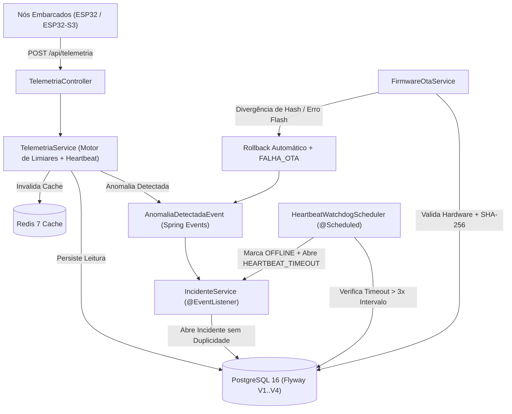

# ⚡ EdgePulse API — Plataforma de Telemetria IoT/ESP32, Tolerância a Falhas e Engenharia de Dependabilidade (MTBF/MTTR)


---

## 📌 Visão Geral do Projeto

O **EdgePulse API** é uma plataforma backend de nível industrial projetada para **monitoramento de clusters de dispositivos embarcados (ESP32 / ESP32-S3 / ESP32-C3)**, ingestão contínua de telemetria física e diagnóstico de periféricos (displays OLED/TFT e codecs de áudio I2S), **tolerância a falhas com detecção automática de anomalias**, **Watchdog de Heartbeat** e cálculo rigoroso de métricas de **Engenharia de Confiabilidade e Dependabilidade (`MTBF`, `MTTR` e `Disponibilidade`)**, além de gerenciamento de atualizações de firmware **Over-The-Air (OTA)** com validação criptográfica **SHA-256** e **Rollback Automático**.

---

## 🏗️ Arquitetura do Sistema e Fluxo de Eventos



### Pilares Arquiteturais
- **Persistência Versionada com Flyway:** 4 migrations SQL (`V1` a `V4`) modelando `clusters`, `dispositivos`, `leituras_telemetria`, `incidentes`, `releases_firmware` e `implantacoes_ota`.
- **Controle de Concorrência Otimista (`@Version`):** Protege a entidade `Dispositivo` contra condições de corrida (*race conditions*) entre pulsos de telemetria simultâneos, varreduras do Watchdog e transições de atualização OTA, retornando `HTTP 409 Conflict` padronizado via `GlobalExceptionHandler`.
- **Cache Distribuído com Redis:** Consultas de topologia de clusters e dispositivos utilizam `@Cacheable`, com invalidação transacional (`@CacheEvict`) em mudanças de estado.
- **Arquitetura Orientada a Eventos Internos:** Desacoplamento entre a ingestão de pacotes de telemetria/OTA e a abertura de incidentes através do `ApplicationEventPublisher` (`AnomaliaDetectadaEvent`).

---

## 📐 Engenharia de Dependabilidade: Fórmulas de MTBF, MTTR e Disponibilidade

O motor matemático do `IncidenteService` calcula os indicadores clássicos de confiabilidade para cada dispositivo embarcado e consolida as médias por cluster no `DashboardService`:

### 1. Tempo Médio Para Reparo (*Mean Time To Repair* — $\text{MTTR}$)
Representa a média aritmética do tempo gasto para mitigar e resolver incidentes operacionais concluídos (`RESOLVIDO`):

$$\text{MTTR} = \frac{\sum_{i=1}^{N_{\text{resolvidos}}} (t_{\text{resolução}, i} - t_{\text{abertura}, i})}{N_{\text{resolvidos}}}$$

### 2. Tempo de Operação Efetiva (*Uptime*) e Tempo Médio Entre Falhas (*Mean Time Between Failures* — $\text{MTBF}$)
A partir do tempo total monitorado desde o cadastro do nó ($T_{\text{total}}$) subtraído do tempo total em falha/reparo ($T_{\text{downtime}}$):

$$\text{Uptime} = T_{\text{total}} - T_{\text{downtime}}$$

$$\text{MTBF} = \frac{\text{Uptime}}{N_{\text{total de incidentes}}}$$

*(Quando o dispositivo não registra falhas, $N_{\text{total}} = 0$, o $\text{MTBF}$ equivale ao próprio $\text{Uptime}$ e a disponibilidade é de $100.00\%$).*

### 3. Disponibilidade Inerente ($\text{Availability}$)
Expressa em percentual com arredondamento `HALF_UP` de 2 casas decimais:

$$\text{Disponibilidade (\%)} = \left( \frac{\text{MTBF}}{\text{MTBF} + \text{MTTR}} \right) \times 100$$

---

## 🚨 Motor de Detecção de Anomalias e Watchdog de Heartbeat

Durante cada ingestão em `POST /api/telemetria`, o `TelemetriaService` inspeciona os parâmetros vitais do ESP32 em tempo real:

| Tipo de Anomalia | Condição de Disparo | Severidade do Incidente | Ação Automática |
| :--- | :--- | :---: | :--- |
| `SUPERAQUECIMENTO` | `temperaturaCpuC > 80.0 °C` | `CRITICA` | Dispositivo `DEGRADADO` + Evento |
| `SUBTENSAO_ELETRICA` | `tensaoAlimentacaoV < 3.0 V` | `CRITICA` | Dispositivo `DEGRADADO` + Evento |
| `BATERIA_CRITICA` | `nivelBateriaPct < 10%` | `ALTA` | Dispositivo `DEGRADADO` + Evento |
| `FALHA_PERIFERICO_DISPLAY` | Display ativo no nó e `statusDisplayOk == false` | `ALTA` | Dispositivo `DEGRADADO` + Evento |
| `FALHA_PERIFERICO_AUDIO` | Áudio I2S ativo no nó e `statusAudioOk == false` | `ALTA` | Dispositivo `DEGRADADO` + Evento |
| `HEARTBEAT_TIMEOUT` | Silêncio $> 3 \times \text{intervaloHeartbeatSegundos}$ do cluster | `CRITICA` | Dispositivo `OFFLINE` + Incidente |
| `FALHA_OTA` | Erro de gravação flash ou divergência de hash SHA-256 | `ALTA` | Rollback de versão + `DEGRADADO` |

---

## 🔄 Gerenciador de Firmware OTA com Validação SHA-256 e Rollback Automático

1. **Publicação de Release (`POST /api/ota/releases`):** Exige versão única, modelo de hardware alvo (`ESP32-S3`, `ESP32-WROOM-32`, etc.) e assinatura hexadecimal **SHA-256 de 64 caracteres**.
2. **Início de Rollout (`POST /api/ota/implantacoes`):**
   - Bloqueia atualização caso o dispositivo esteja `OFFLINE`, em `MANUTENCAO` ou já possua outra implantação ativa.
   - Valida compatibilidade estrita de hardware (`modeloHardwareAlvo == dispositivo.modeloHardware`) e exige `estavel = true`.
   - Salva um snapshot da versão atual em `versaoAnterior` e transiciona o dispositivo para `EM_ATUALIZACAO`.
3. **Callback de Verificação e Rollback (`PATCH /api/ota/implantacoes/{id}/resultado`):**
   - **Sucesso + Checksum SHA-256 Idêntico:** Efetiva a nova versão de firmware no dispositivo, encerra a implantação como `SUCESSO` e restaura o status para `ONLINE`.
   - **Falha Física ou Hash SHA-256 Divergente:** Aciona o **Rollback Automático**, marca a implantação como `FALHA_ROLLBACK`, restaura imediatamente a `versaoAnterior` no registro do dispositivo, altera seu status para `DEGRADADO` e publica um `AnomaliaDetectadaEvent` (`FALHA_OTA`).

---

## 📡 Tabela Completa de Endpoints REST

A documentação interativa do **Swagger UI** fica disponível em `http://localhost:8080/swagger-ui.html` e a especificação OpenAPI 3 JSON em `http://localhost:8080/v3/api-docs`.

| Domínio | Método | Endpoint | Descrição |
| :--- | :---: | :--- | :--- |
| **Health** | `GET` | `/api/health` | Verifica status da API e motor de telemetria |
| **Clusters** | `POST` | `/api/clusters` | Cria um novo cluster de dispositivos embarcados |
| **Clusters** | `GET` | `/api/clusters` | Lista todos os clusters (com cache) |
| **Clusters** | `GET` | `/api/clusters/{id}` | Busca um cluster pelo ID |
| **Dispositivos** | `POST` | `/api/dispositivos` | Cadastra nó embarcado ESP32 (normaliza MAC Address) |
| **Dispositivos** | `GET` | `/api/dispositivos` | Lista todos os dispositivos embarcados |
| **Dispositivos** | `GET` | `/api/dispositivos/{id}` | Busca dispositivo por ID |
| **Dispositivos** | `GET` | `/api/dispositivos/mac/{macAddress}` | Busca dispositivo pelo MAC Address |
| **Dispositivos** | `GET` | `/api/dispositivos/cluster/{clusterId}` | Lista dispositivos de um cluster específico |
| **Dispositivos** | `PATCH` | `/api/dispositivos/{id}/status` | Atualiza status operacional do dispositivo (`@Version`) |
| **Telemetria** | `POST` | `/api/telemetria` | Ingere pacote de telemetria, atualiza heartbeat e avalia anomalias |
| **Telemetria** | `GET` | `/api/telemetria/dispositivo/{dispositivoId}` | Histórico de leituras de telemetria do nó |
| **Telemetria** | `GET` | `/api/telemetria/dispositivo/{dispositivoId}/ultima` | Retorna a última leitura enviada pelo dispositivo |
| **Telemetria** | `GET` | `/api/telemetria/anomalias` | Lista todas as leituras com anomalia detectada |
| **Telemetria** | `GET` | `/api/telemetria/dispositivo/{dispositivoId}/resumo` | Resumo estatístico (médias de temperatura e tensão) |
| **Incidentes & MTBF** | `GET` | `/api/incidentes` | Lista todos os incidentes operacionais |
| **Incidentes & MTBF** | `GET` | `/api/incidentes/dispositivo/{dispositivoId}` | Lista incidentes por dispositivo |
| **Incidentes & MTBF** | `POST` | `/api/incidentes` | Abre um incidente operacional manualmente |
| **Incidentes & MTBF** | `PATCH` | `/api/incidentes/{id}/resolver` | Resolve incidente, calcula tempo de reparo e restaura nó |
| **Incidentes & MTBF** | `POST` | `/api/incidentes/watchdog/verificar` | Aciona varredura manual do Watchdog de Heartbeat |
| **Incidentes & MTBF** | `GET` | `/api/incidentes/dispositivo/{dispositivoId}/confiabilidade` | Calcula `MTBF`, `MTTR`, `Uptime` e `Disponibilidade (%)` |
| **Firmware OTA** | `POST` | `/api/ota/releases` | Publica nova release de firmware com hash SHA-256 |
| **Firmware OTA** | `GET` | `/api/ota/releases` | Lista todas as releases de firmware |
| **Firmware OTA** | `POST` | `/api/ota/implantacoes` | Inicia rollout OTA validando modelo de hardware |
| **Firmware OTA** | `PATCH` | `/api/ota/implantacoes/{id}/resultado` | Confirma sucesso SHA-256 ou executa Rollback Automático |
| **Firmware OTA** | `GET` | `/api/ota/implantacoes/dispositivo/{dispositivoId}` | Histórico de atualizações OTA do dispositivo |
| **Dashboard** | `GET` | `/api/dashboard/global` | Resumo executivo global de toda a plataforma |
| **Dashboard** | `GET` | `/api/dashboard/clusters` | Dashboards de saúde de todos os clusters ativos |
| **Dashboard** | `GET` | `/api/dashboard/clusters/{clusterId}` | Diagnóstico de saúde (`SAUDAVEL`, `ATENCAO`, `CRITICO`) do cluster |

---

## 🚀 Guia de Execução Local e com Docker

### Pré-requisitos
- **Java 21 LTS** (Eclipse Temurin / OpenJDK 21)
- **Maven 3.9+** (ou utilize o `./mvnw` incluso)
- **Docker & Docker Compose**

### Opção 1: Subir Infraestrutura Completa via Docker Compose
```bash
docker compose up -d --build
```
- API disponível em: `http://localhost:8080`
- Swagger UI: `http://localhost:8080/swagger-ui.html`

### Opção 2: Subir apenas PostgreSQL + Redis no Docker e rodar a API via Maven
```bash
docker compose up -d postgres redis
./mvnw spring-boot:run
```

### Executando a Suíte de Testes Automatizados (100% Isolada em Memória)
Os testes utilizam o perfil `test` (`application-test.yml`) com **H2 em modo de compatibilidade PostgreSQL**, migrations do **Flyway** ativas e cache em memória, dispensando conexões externas:
```bash
./mvnw -B clean test
```

### Testando os Endpoints Rapidamente
Utilize a coleção pronta em [`docs/api-requests.http`](docs/api-requests.http) diretamente no **IntelliJ HTTP Client** ou na extensão **REST Client do VS Code**.
